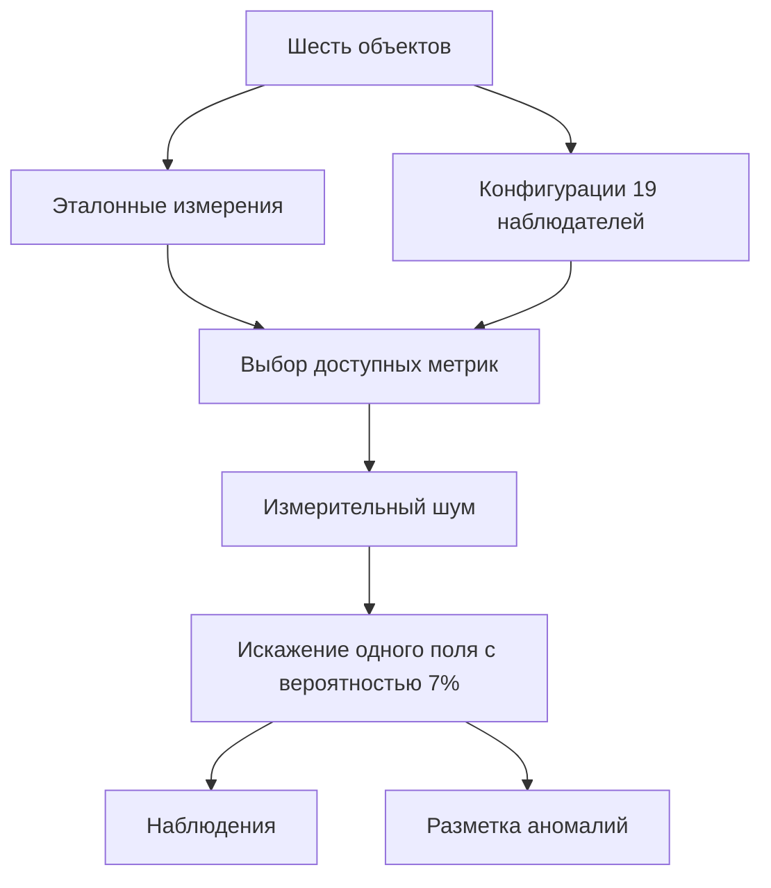

# ДЗ №1. Телеметрия шести объектов

Датасет содержит шесть разных объектов, по одному экземпляру каждого вида, и 19 наблюдателей. Измерения формируются каждые 100 мс.

## Концептуальная схема



| Объект | Наблюдателей | Метрик у объекта / наблюдателя | Три общие метрики | Дополнительные метрики |
|---|---:|---:|---|---|
| Токарный станок (`lathe`) | 3 | 10 / 7 | Обороты шпинделя, нагрузка, температура двигателя | Ток, напряжение, мощность, температура корпуса, виброскорость X, Y и Z |
| Насос (`pump`) | 4 | 8 / 6 | Расход, давление на выходе, температура двигателя | Давление на входе, обороты крыльчатки, мощность, температура жидкости, виброскорость |
| Компрессор (`compressor`) | 3 | 9 / 7 | Давление нагнетания, расход воздуха, температура нагнетания | Температура на входе, обороты вала, давление масла, мощность, виброскорость, точка росы |
| Печь (`furnace`) | 3 | 8 / 6 | Температура камеры, мощность нагревателя, температура выхлопа | Температура стенки, обороты вентилятора, расход воздуха, доля кислорода, температура дверцы |
| Конвейер (`conveyor`) | 3 | 9 / 7 | Скорость ленты, масса груза, температура привода | Натяжение ленты, крутящий момент, мощность привода, виброскорость ролика, смещение ленты, производительность |
| Чиллер (`chiller`) | 3 | 8 / 6 | Температуры подачи и обратки, расход теплоносителя | Давление испарения, давление конденсации, обороты вентилятора, холодопроизводительность, потребляемая мощность |

Каждому наблюдателю назначаются три общие метрики своего объекта и три или четыре дополнительных. Дополнительные поля выбираются по `seed` при запуске и фиксируются на весь прогон. У наблюдателей одного объекта наборы различаются, а вместе они покрывают все его метрики. Конкретные назначения записываются в `observers.csv`.

Эталонные показания рассчитываются по синтетической модели, где метрики зависят от режима работы объекта. Код модели, имена полей, единицы в суффиксах и стандартные отклонения измерительного шума задаются в `equipment.py`. К каждому доступному полю добавляется гауссов шум. С вероятностью 7% на строку одно из доступных полей получает дополнительный сдвиг случайного знака на 8–16 стандартных отклонений шума.

## Схема типов и связи

Два общих справочника и три таблицы на каждый вид оборудования дают **20 логических таблиц**. Таблицы измерений и разметки записываются в CSV-части.

| Таблица | Ключ | Поля |
|---|---|---|
| `machines.csv` | `machine_id` | `machine_id: uint16`, `kind: string` |
| `observers.csv` | `observer_id` | `observer_id: uint16`, `machine_id: uint16`, `observer_type: string`, `observed_fields: list<string>` |
| `ground_truth/<kind>/part-*.csv` | `machine_id, timestamp_ms` | `machine_id: uint16`, `timestamp_ms: int64`, все метрики объекта `float32` |
| `observations/<kind>/part-*.csv` | `observer_id, timestamp_ms` | `observer_id: uint16`, `timestamp_ms: int64`, общие метрики `float32` и дополнительные `float32?` |
| `anomaly_labels/<kind>/part-*.csv` | `observer_id, timestamp_ms` | `observer_id: uint16`, `timestamp_ms: int64`, `field: string`, `delta: float32` |

В CSV типы приводятся при чтении. Пустая ячейка означает недоступную метрику. Время хранится в миллисекундах Unix в UTC, а список `observed_fields` разделён символом `|`. Наблюдение связывается с эталоном через `observer_id → machine_id` и время. Разметка связывается с наблюдением по идентификатору наблюдателя и времени. Поле `delta` хранит сдвиг в единицах изменённой метрики.

## Запуск

Нужен Python 3.10 или новее. В архиве `sample_v2` содержит 10 секунд данных. Имя файла с предсказаниями и путь для новой генерации должны быть свободны.

```powershell
python detect.py sample_v2 --output predictions.csv --evaluate
python generate.py --output demo --steps 100 --seed 42
python generate.py --output data --target-bytes 10000000000 --seed 42
```

Полная часть содержит 10 000 шагов, 60 000 эталонных строк и 190 000 наблюдений. Целевой объём считается по сумме размеров CSV и проверяется после завершения каждой части.

Детектор сравнивает три общие метрики каждого объекта с медианой его наблюдателей. Для тока токарного станка дополнительно используется модель по нагрузке и история остатков. Подробности в [ANOMALY_DETECTION.md](ANOMALY_DETECTION.md).
