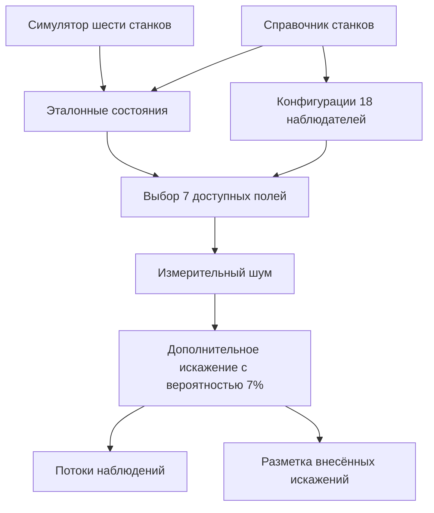

# ДЗ №1. Телеметрия станков

Синтетический датасет для сопоставления частичных наблюдений с эталоном и поиска искажённых показаний. Шесть станков наблюдаются восемнадцатью источниками, по три на станок. Каждый источник выдаёт одно наблюдение каждые 100 мс.

## Концептуальная схема источников



У всех наблюдателей есть обороты шпинделя, нагрузка и температура двигателя. Для каждого станка генератор случайно выбирает каждому наблюдателю ещё четыре поля. Жеребьёвка повторяется, пока наборы всех трёх наблюдателей не будут различаться и вместе покрывать все семь дополнительных полей. Распределение сохраняется в справочнике и действует весь прогон.

Эталон рассчитывается каждые 100 мс. В модели ток зависит от нагрузки, мощность от тока и напряжения, температура двигателя и корпуса изменяется с задержкой относительно цикла нагрузки. Каждый наблюдатель добавляет независимый нормальный шум с нулевым средним и отдельной шкалой для каждого поля. С вероятностью 7% на строку генератор выбирает одно из семи доступных полей и добавляет отклонение случайного знака величиной от 8 до 16 стандартных отклонений штатного шума. Разметка хранит разницу между итоговым и штатным показанием после округления. Для недоступного поля в CSV остаётся пустая ячейка.

## Параметры

| Поле | Параметр | Единица | Доступ | σ шума |
|---|---|---|---|---:|
| `speed_rpm` | Обороты шпинделя | об/мин | Всем | 3 |
| `load_pct` | Нагрузка двигателя | % | Всем | 0,25 |
| `motor_temp_c` | Температура двигателя | °C | Всем | 0,12 |
| `current_a` | Ток двигателя | А | По жребию | 0,04 |
| `voltage_v` | Напряжение питания | В | По жребию | 0,25 |
| `power_kw` | Активная мощность | кВт | По жребию | 0,025 |
| `case_temp_c` | Температура корпуса | °C | По жребию | 0,10 |
| `vibration_x_mm_s` | Виброскорость по X | мм/с | По жребию | 0,012 |
| `vibration_y_mm_s` | Виброскорость по Y | мм/с | По жребию | 0,012 |
| `vibration_z_mm_s` | Виброскорость по Z | мм/с | По жребию | 0,012 |

## Схема типов

| Таблица | Ключ | Поля |
|---|---|---|
| `machines` | `machine_id` | `machine_id: uint16`, `name: string` |
| `observers` | `observer_id` | `observer_id: uint16`, `machine_id: uint16` → `machines`, `observed_fields: list<string>` |
| `ground_truth` | `machine_id, timestamp_ms` | `machine_id: uint16` → `machines`, `timestamp_ms: int64`, все 10 параметров `float32` |
| `observations` | `observer_id, timestamp_ms` | `observer_id: uint16` → `observers`, `timestamp_ms: int64`, 3 обязательных параметра `float32`, 7 дополнительных `float32?` |
| `anomaly_labels` | `observer_id, timestamp_ms` | Составной внешний ключ → `observations`, `field: string`, `delta: float32` в единицах искажённого параметра |

В CSV типы применяются при чтении. `timestamp_ms` — миллисекунды Unix в UTC. Список `observed_fields` разделяется символом `|`. В каждой строке наблюдений семь чисел и три пустые ячейки среди полей параметров. Чтобы связать наблюдение с эталоном, найдите `machine_id` по `observer_id`, затем соедините строки по `machine_id, timestamp_ms`. Строка разметки существует для каждого внесённого искажения.

## Генерация данных

Требуется Python 3.10 или новее. Генератор использует стандартную библиотеку. В папке `sample` есть выгрузка за 10 секунд симуляции с `seed=42`.

```powershell
python generate.py --output sample-copy --steps 100 --seed 42
python generate.py --output data --target-bytes 10000000000 --seed 42
```

Папка назначения должна быть новой. Цель 10 ГБ считается по суммарному размеру всех CSV на диске. Генератор держит в памяти один шаг симуляции и проверяет объём после каждой завершённой части. Одна часть содержит до 10 000 шагов, поэтому полный набор может превысить цель максимум на размер последней части. Папка `data` исключена из Git.
